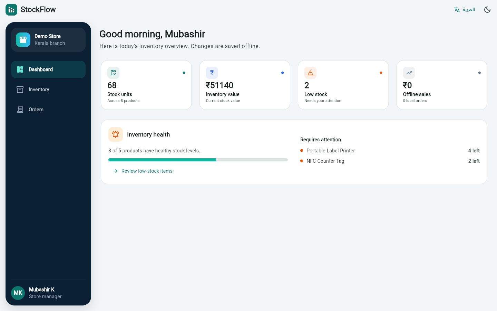
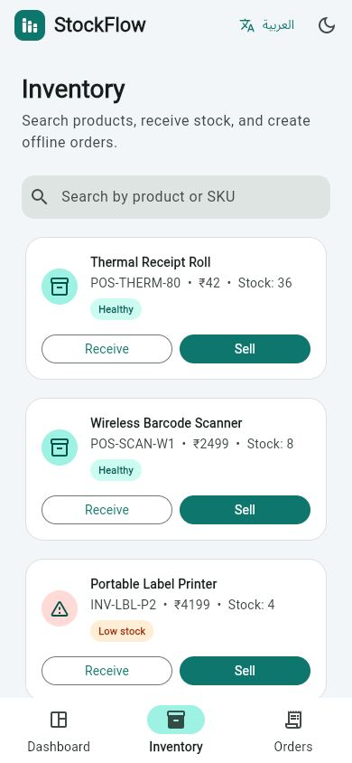

# StockFlow

[](https://github.com/MuhammedMubashir-dev/stockflow-flutter/actions/workflows/flutter-ci.yml)

StockFlow is an original, offline-first inventory and order-management application built with Flutter. It is designed as a public portfolio project that demonstrates production-minded mobile development without using proprietary company code or data.

**Live demo:** Coming soon

**Android demo:** Download the latest APK from [GitHub Releases](https://github.com/MuhammedMubashir-dev/stockflow-flutter/releases/latest).

## Preview

### Desktop dashboard



### Mobile inventory

<p align="center">
  
</p>

## Highlights

- Responsive Material 3 interface for phones, tablets, and the web
- Restrained navy-teal design system with operational KPI cards
- Purpose-built desktop sidebar and compact mobile navigation
- Dashboard with inventory value, stock levels, low-stock alerts, and sales totals
- Product and SKU search
- Stock receiving and offline order creation
- Local persistence with `shared_preferences`
- English and Arabic interface with RTL layout switching
- Light and dark themes
- Healthy, low-stock, and out-of-stock status indicators
- Riverpod state management
- Repository, domain, application, and presentation separation
- Widget test coverage for the primary dashboard flow

## Architecture

```text
lib/
├── application/   # Riverpod state and business operations
├── data/          # Offline persistence and seed data
├── domain/        # Product, order, and inventory models
└── presentation/  # Responsive user interface
```

The repository abstraction keeps persistence separate from business logic. `InventoryController` owns stock and order operations, while the presentation layer observes immutable `InventoryState` through Riverpod.

## Run locally

```bash
flutter pub get
flutter run
```

Choose Chrome for the responsive web demo or an Android device/emulator for the mobile experience.

## Quality checks

```bash
flutter analyze
flutter test
flutter build web
```

## Demo data

The application ships with fictional POS and logistics inventory. All changes remain on the current device. No paid API, backend account, credentials, or company data are required.

## Roadmap

- Drift-backed transactional storage
- Background synchronization with a mock REST service
- Authentication and role-based permissions
- PDF invoice generation
- Additional unit and integration tests
- Installable Android demo build

## License

Licensed under the [MIT License](LICENSE).
